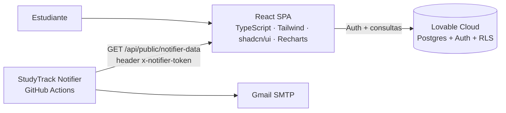

# 📚 StudyTrack

Panel de seguimiento de hábitos de estudio para estudiantes universitarios: registrá cuánto estudiás cada materia, definí metas semanales y mirá tu progreso en gráficos.

**🔗 Demo en vivo:** https://pixel-perfect-replay-25677.lovable.app
**🧪 Cuenta demo:** `demo@ejemplo.com` / `TU-CLAVE-DEMO` <!-- TODO: crear una cuenta demo con datos -->


## ✨ Funcionalidades
- Registro e inicio de sesión (email y contraseña) con rutas protegidas
- **Dashboard:** horas de la semana, racha de días, % de cumplimiento de metas, horas por materia vs. meta, evolución de 4 semanas y distribución del tiempo
- **Materias:** color, meta semanal en horas, progreso y archivado
- **Sesiones de estudio:** cronómetro (iniciar / pausar / finalizar) o carga manual, con historial filtrable
- **Exámenes:** cuenta regresiva en días
- Diseño responsive con modo claro y oscuro

## 🧱 Arquitectura

- **Frontend:** SPA en React con TypeScript; los gráficos usan Recharts.
- **Backend:** Lovable Cloud (Supabase): autenticación y base de datos PostgreSQL.
- **Seguridad:** *Row Level Security*: cada usuario solo puede leer y modificar sus propios datos.
- **Integración:** un endpoint protegido por token alimenta a [StudyTrack Notifier](https://github.com/Axel-B-P/studytrack-notifier), que envía recordatorios y resúmenes por mail.

## 🗄️ Modelo de datos
| Tabla | Campos principales |
|---|---|
| `profiles` | id, nombre |
| `subjects` | id, user_id, nombre, color, meta_semanal_horas, archivada |
| `study_sessions` | id, user_id, subject_id, fecha, duracion_minutos, nota |
| `exams` | id, user_id, subject_id, titulo, fecha |

## 🛠️ Stack
React · TypeScript · Vite · Tailwind CSS · shadcn/ui · Recharts · Lovable Cloud (Supabase) · PostgreSQL

## 🚀 Cómo correrlo
```bash
git clone https://github.com/Axel-B-P/studytrack.git
cd studytrack
npm install
npm run dev
```
Las variables de entorno del backend (`VITE_SUPABASE_URL` y la clave pública) ya vienen configuradas en el proyecto de Lovable. Para usar tu propio backend, creá un proyecto en Supabase, ejecutá las migraciones de `supabase/migrations` y reemplazá esos valores en `.env`.

## 📸 Capturas
| Dashboard | Sesiones | Materias |
|---|---|---|
|  |  |  |

## 👤 Autor
**Axel Bedogni Paz** · [GitHub](https://github.com/Axel-B-P) · [LinkedIn](https://www.linkedin.com/in/TU-USUARIO) · [Portafolio](https://TU-PORTAFOLIO)
